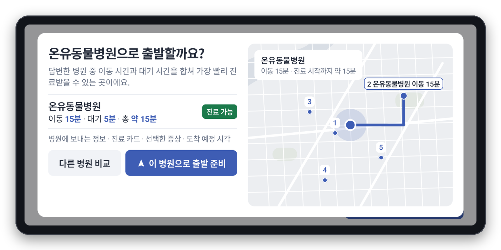
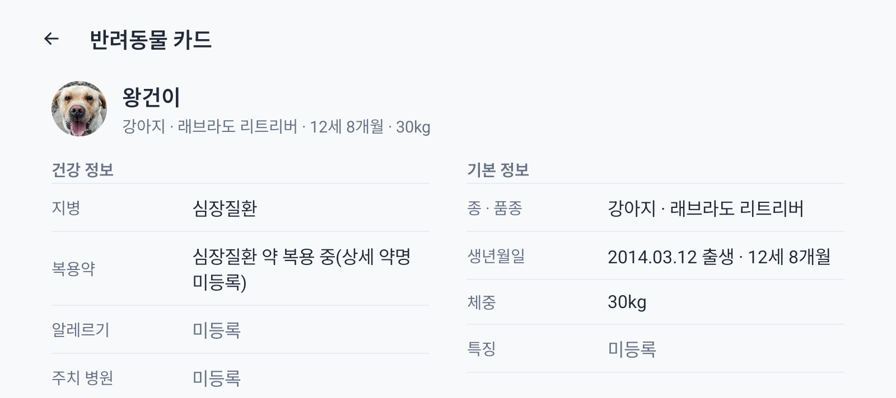

<p align="center"></p>

<h1 align="center">멍쾌 · MeongCare</h1>

<p align="center"><b>멍쾌는 반려동물의 응급 상황부터 일상 진료까지, 가장 빠른 진료 연결과 차량 기반 맞춤 케어를 통해<br>병원 이동 전·중·후의 모든 과정을 함께하는 반려동물 헬스케어 코파일럿입니다.</b></p>

<p align="center">
  
  
  
  
  
  
</p>

<p align="center">
  <a href="#핵심-기능">핵심 기능</a> ·
  <a href="#전체-화면">전체 화면</a> ·
  <a href="#차량이라서-가능한-것">차량이라서 가능한 것</a> ·
  <a href="#서비스-생태계">서비스 생태계</a> ·
  <a href="#시연-범위">시연 범위</a> ·
  <a href="#실행-가이드">실행 가이드</a> ·
  <a href="#팀">팀</a>
</p>

<p align="center"></p>
<p align="center"><sub>응급 진료 시작 → 증상 선택 → 진료 카드 → 동물병원 응답 확인 → 출발 → 병원 도착 → 진료 완료 → 귀가</sub></p>

## 핵심 기능

**1. 당황한 순간에도, 증상만 고르면 진료 카드 완성** — 큰 증상 카드를 누르기만 하면 반려견 정보와 합쳐져 병원에 보낼 진료 카드가 됩니다. 목록에 없는 증상은 말로 설명합니다.

<p align="center"></p>

**2. 병원마다 전화할 필요 없이, 근처 동물병원에 한 번에 문의** — 20초 안에 답한 병원과 진료 불가 병원을 색으로 한눈에 보여 줍니다.

<p align="center"></p>

**3. 가장 가까운 곳이 아니라, 가장 빨리 진료받는 곳으로** — 이동 시간과 대기 시간을 합쳐 최적의 병원을 먼저 제안하고, 경로를 지도에 그립니다.

<p align="center"></p>

**4. 도착했을 땐 이미 병원이 보리를 알고 있습니다** — 진료 카드가 먼저 가 있어 접수 설명이 필요 없고, 차 안에서 기다리다 진료 차례가 되면 알려 줍니다.

<p align="center"></p>

## 전체 화면

<details>
<summary><b>나머지 화면 보기</b> (9장)</summary>

| 홈 · 응급 진료 | 진료 카드 확인 |
|---|---|
|  |  |
| **출발 확인** | **병원으로 이동 중** |
|  |  |
| **진료 완료** | **귀가 중** |
|  |  |
| **귀가 완료** | **반려동물 카드** |
|  |  |
| **릴렉스 모드** | |
|  | |

</details>

## 차량이라서 가능한 것

<p align="center"></p>

| Pleos SDK | 멍쾌에서 하는 일 |
|---|---|
| **Vehicle** · AAOS `CarUxRestrictions` | 주행 중엔 남은 시간만 크게, 정차 중에만 입력과 상세 화면 |
| **NaviHelper** | 고른 병원을 목적지로 설정, 길 안내는 차량 내비게이션이 |
| **SpeechToText** (`ON_DEVICE`) | 목록에 없는 증상은 말로 설명 |

차량 디스플레이(1682×1210) 기준으로 설계했습니다. 모든 SDK는 래퍼 뒤에 두고 Fake 구현을 함께 만들어 PC·테스트·시연 영상에서도 같은 흐름이 동작합니다.

## 서비스 생태계

| | 하는 일 |
|---|---|
| **보호자 웹** (폰) | 반려동물 의료정보를 등록하고, 차 화면의 연결 코드로 차와 연결 |
| **멍쾌** (차) | 증상 → 병원 선택 → 이동 → 진료 → 귀가 |
| **병원 웹** | 대기 시간을 알리고, 진료 카드와 도착 예정을 실시간으로 받음 |

보호자 · 차 · 동물병원을 잇는 구조라서, 제휴 병원과 진료 기록이 쌓일수록 다음 이동이 더 빨라집니다.

현재 출품작에서 실제로 동작하는 범위는 아래 [시연 범위](#시연-범위)에 정리했습니다.

## 기술 구조

- **Android 앱**: Kotlin, Jetpack Compose(Material3), MVVM, 수동 DI. 단일 `app` 모듈.
- **웹**: React + Vite + TypeScript (보호자 웹 · 병원 웹).
- **서버**: Firebase (Firestore, 익명 로그인). 서버가 없어도 앱은 내장 데이터로 끝까지 동작합니다.
- **품질**: 단위 테스트(Android·웹), 커밋마다 빌드 확인, dev 반영 전 검증 파이프라인.
- 자세한 구조: [docs/architecture.md](docs/architecture.md)
- 버전: 아래 [SDK와 버전](#sdk와-버전)

## 시연 범위

출품작은 시연 환경에서 동작합니다. 아래 항목은 **실제 서비스와 연동하지 않고, 정해 둔 데이터와 시나리오로 동작**합니다. 앱 화면에는 따로 표시하지 않습니다.

| 항목 | 시연 내용 |
|---|---|
| 반려견 "보리" | 샘플 반려견입니다. 사진·체중·특징은 정해 둔 값입니다 (보호자 웹과 연결하면 등록한 정보로 바뀝니다) |
| 시연 동물병원 | 가상 병원입니다. 이름·거리·이동 시간·전화번호(`02-0000-002N`)는 실제가 아닙니다 |
| 병원 답변 · 진료 차례 호출 | 앱 안에서 정해 둔 시나리오로 옵니다. 병원 웹과 연결하지 않습니다 |
| 진료 카드 전송 (시연 병원) | 앱 안에서만 보낸 것으로 처리합니다 |
| 길 안내 | 차량 기기에서는 Pleos 내비가 실제 경로를 안내합니다. 폰·태블릿에서는 앱 안에서 정해 둔 길안내로 진행합니다. "병원 도착"은 버튼으로 처리합니다 |
| 지도 | 실제 지도가 아니라 그린 그림입니다 |
| 릴렉스 모드 | 설정 화면만 있습니다. 차량 공조·음악에는 적용하지 않습니다 |
| 진료 기록 | 앱 메모리에만 저장합니다. 보호자 웹 저장과 병원 전달은 아직 없습니다 |
| 음성 | 증상 음성 입력은 차량 기기에서만 실제로 듣습니다. [음성 명령]·음성 안내 소리는 준비 중입니다 |

더 자세한 내용: [docs/product/feature-facts.md](docs/product/feature-facts.md)

---

# 실행 가이드

**Pleos Connect 에뮬레이터**에서 실행하는 기준입니다. 서버 없이도 전체 흐름이 끝까지 동작합니다. 보호자 웹 연결까지 보려면 [로컬 서버로 전체 시연](#로컬-서버로-전체-시연-선택)을 이어서 합니다.

## 테스트 환경

| 항목 | 값 |
|---|---|
| 에뮬레이터 | Pleos Connect Emulator v2.1.0 (Android API 34, 시스템 이미지 `pleos_car_emulator`) |
| 화면 규격 | 2560×1440, mdpi(160dpi), 12.8인치. 앱은 오른쪽 앱 영역 **1682×1210dp(가로)**에 뜹니다 |
| 실행 조건 | GPU 필수, **Cold boot**로 켭니다 |
| 앱 | `com.meongcare.app`, minSdk 28 / target SDK 35 |
| 위치 | 에뮬레이터 내비의 현재 위치 (기본 시흥동). 내비 화면을 한 번 띄워야 위치가 옵니다 |

에뮬레이터 설치: [docs/pleos/emulator-setup.md](docs/pleos/emulator-setup.md)

## 빌드

Android Studio 없이 Gradle wrapper만으로 빌드됩니다.

1. 준비물
   - JDK 17 이상 (JDK 21에서 확인)
   - Android SDK Platform 35, Build-Tools 35
   - `ANDROID_HOME` 환경 변수, 또는 저장소 루트 `local.properties`의 `sdk.dir`
2. (선택) 음성 인식이나 로컬 서버를 쓸 때만 `secrets.properties.example`을 복사해 `secrets.properties`를 만듭니다 (커밋하지 않습니다). 없어도 빌드됩니다.
3. 빌드, 단위 테스트, 린트:

   ```
   ./gradlew assembleDebug
   ./gradlew testDebugUnitTest
   ./gradlew lintDebug
   ```

   Windows PowerShell에서는 `.\gradlew.bat`을 씁니다.
4. APK: `app/build/outputs/apk/debug/app-debug.apk`

## 설치와 업데이트

에뮬레이터를 켠 뒤 adb로 설치합니다 (Android Studio의 Run으로 설치해도 됩니다).

| 경우 | 명령 | 확인할 것 |
|---|---|---|
| 신규 설치 | `adb uninstall com.meongcare.app` (있으면) → `adb install app/build/outputs/apk/debug/app-debug.apk` | 런처에서 MeongCare(멍쾌)가 켜지고 홈 화면(응급 진료)이 보입니다 |
| 업데이트 | `adb install -r app/build/outputs/apk/debug/app-debug.apk` | 앱이 그대로 켜지고, debug 패널에서 고른 데이터 모드가 유지됩니다 |

## 실행과 시연

1. 앱을 켭니다. debug 빌드는 **Fake 모드**로 켜집니다.
2. 화면 아래 debug 패널 오른쪽 위 버튼으로 **시연 모드**로 바꿉니다 (누를 때마다 Fake → 시연 → Real, 바꾸면 앱이 다시 시작됩니다). 패널 제목이 `DEBUG · 시연`이면 됩니다.
   - 시연 모드: 주행·정차는 차량의 실제 주행 규제 값, 경로는 Pleos 내비게이션, 병원 답변·남은 시간·도착은 앱 안에서 정해 둔 시나리오.
3. 주행·정차는 Virtual Console의 기어로 바꿉니다: `adb forward tcp:8088 tcp:8088` → PC 브라우저로 `http://127.0.0.1:8088/` → Emulation Controls → Motion → Gear Selection. 처음에는 **P(정차)**입니다.
4. 시연 시나리오 (P 상태에서):
   1. 홈 **[응급 진료 시작]** → 증상 카드를 고릅니다 (예: 호흡 곤란, 구토) → **[증상 확인하기]**
   2. 진료 카드 확인 (반려견 정보 + 고른 증상) → **[동물병원 찾기]**
   3. 동물병원 응답 확인: 근처 병원 5곳에 문의하고 20초 동안 답을 기다립니다 (카운트다운, 응답 상태별 색)
   4. "○○으로 출발할까요?" → **[이 병원으로 출발 준비]** → 출발 확인 → **[목적지 설정하고 출발]**
   5. Pleos 내비가 병원 경로를 계산하고 안내를 시작합니다 (10~20초). GNB의 MeongCare 아이콘으로 돌아오면 "병원으로 이동 중" 화면이 나옵니다
   6. 기어 **D** → 주행 화면 (남은 시간만 크게). 기어 **P** → 다시 이동 중 화면
   7. **[✓ 병원 도착]** → 병원 도착 화면. [차 안에서 대기]를 켜면 잠시 뒤 진료 차례 알림이 옵니다
   8. **[진료 완료]** → 진료 기록 **[저장]** → **[귀가 출발]** → **[귀가 완료]**
5. 다른 경우
   - 모든 병원이 답하지 않는 경우: debug 패널 **[문의 시연: 응답 없음]** → 20초 뒤 [조금 더 기다리기] / [가장 가까운 병원으로 안내]
   - 홈의 [병원 찾기], [릴렉스], [반려동물 카드]
   - 일반 태블릿 에뮬레이터에서도 동작합니다. 이때 주행·정차는 debug 패널의 [정차]/[주행]으로 바꿉니다.

## 로컬 서버로 전체 시연 (선택)

| | 서버 없이 | 로컬 서버를 켜면 |
|---|---|---|
| 반려견 정보 | 샘플 반려견 "보리" | 보호자 웹에서 등록한 정보를 연결 코드로 차에 가져옵니다 |
| 보호자 웹 | 브라우저에만 저장 | 서버에 저장하고 차와 연결 |
| 병원 웹 | 이 브라우저에서만 (예시 환자 1건) | 같은 서버에 붙어 대기 시간 알림·진료 카드 화면을 봅니다 |
| 동물병원 문의·카드 전송 | 앱 안 시연 | 앱 안 시연 (병원 웹으로 보내지 않습니다) |

준비물: Node.js 22.12 이상, Java 21. `firebase-tools` 버전은 `firebase/package.json`에 고정돼 있습니다.

1. Firebase 에뮬레이터 (터미널 하나를 계속 씁니다):

   ```
   npm --prefix firebase ci
   npm --prefix firebase run emulators
   ```

2. 다른 터미널에서 시연 데이터를 넣습니다: `npm --prefix firebase run seed -- --reset`
3. 웹: `web/.env.example`의 로컬 에뮬레이터 세 줄을 `web/.env.local`에 넣고

   ```
   npm --prefix web ci
   npm --prefix web run dev
   ```

   보호자 웹 `http://127.0.0.1:5173/` (폰 크기로 보려면 개발자 도구 기기 모드), 병원 웹 `http://127.0.0.1:5173/hospital/`
4. 차 앱: `secrets.properties`에 아래 값을 넣고 다시 빌드·설치한 뒤 시연 모드로 켭니다.

   ```
   FIREBASE_PROJECT_ID=demo-meongcare
   FIREBASE_API_KEY=demo-key
   FIREBASE_EMULATOR_HOST=127.0.0.1
   ```

5. 시연 직전 점검: `npm --prefix firebase run preflight -- --fix` (서버, `adb reverse`, 시연 데이터를 확인하고 고칠 수 있는 것은 고칩니다)
6. 연결: 보호자 웹에서 반려견 등록 → **[차와 연결하기]** → 동의 → 코드 입력 화면. 차 홈의 **[보호자 웹과 연결]** → 6자리 코드를 보호자 웹에 입력 → 차에 "○○ 보호자와 연결했어요"
   - 연결 화면은 정차 중에만 보이고, 차에서는 글자를 입력하지 않습니다. 코드는 10분 동안 한 번만 쓸 수 있습니다.

### 연결 주소와 포트

| 서비스 | PC 주소 | 차 앱에서 |
|---|---|---|
| Firestore | `127.0.0.1:8080` | `adb reverse tcp:8080 tcp:8080` 후 `127.0.0.1:8080` |
| Auth | `127.0.0.1:9099` | `adb reverse tcp:9099 tcp:9099` 후 `127.0.0.1:9099` |
| Emulator UI | `http://127.0.0.1:4000` | (PC에서만) |
| 보호자·병원 웹 | `http://127.0.0.1:5173` | (PC 브라우저에서) |

- `adb reverse`는 `preflight -- --fix`가 걸어 줍니다. 에뮬레이터를 다시 켜면 다시 걸어야 합니다.
- `adb reverse` 대신 `FIREBASE_EMULATOR_HOST=10.0.2.2`(Android 에뮬레이터에서 본 PC 주소)로도 붙습니다.
- 모두 같은 PC 안의 연결이라 방화벽 설정은 필요 없습니다.
- **projectId는 모두 `demo-meongcare`**로 맞춥니다: 차 앱 `secrets.properties`, 웹 `web/.env.local`, `firebase/.firebaserc`.

### 시연 데이터 초기화

| 목적 | 명령 |
|---|---|
| 처음 상태로 (모두 지우고 시연 병원 5곳 다시 넣기) | `npm --prefix firebase run seed -- --reset` |
| 시연 직전 점검·보정 (대기 정보 시각 갱신, `adb reverse`) | `npm --prefix firebase run preflight -- --fix` |
| 보안 규칙 점검 | `npm --prefix firebase run check-rules` |

자세히: [firebase/README.md](firebase/README.md), [web/README.md](web/README.md)

## SDK와 버전

| 구분 | 사용 | 버전 |
|---|---|---|
| Pleos SDK | Vehicle | `ai.pleos.playground:Vehicle:2.3.2` |
| | NaviHelper (병원 경로 안내, 현재 위치) | `ai.pleos.playground:NaviHelper:3.0.5` |
| | SpeechToText (`ON_DEVICE`, 증상 음성 입력) | `ai.pleos.playground:SpeechToText:3.3.1` |
| AAOS | `CarUxRestrictionsManager` (주행·정차 판단) | Android API 34 에뮬레이터 |
| Pleos 권한 | `NAVI_ROUTE_SEARCH`, `NAVI_ROUTE`, `STT_SERVICE`, `TTS_SERVICE` | |
| Android 앱 | Kotlin 2.0.0, Jetpack Compose + Material3, AGP 8.8.2, Gradle 8.10.2 | minSdk 28 / target 35 |
| 웹 | React + Vite + TypeScript, Vitest | `web/package.json` (버전 고정) |
| 서버 | Firebase 에뮬레이터 (Firestore, 익명 Auth) | `firebase/package.json` (버전 고정) |

## 팀

**P2V (Pet to Vet)**

| 이름 | 역할 |
|---|---|
| 김해림 | 팀장, 서비스 기획 |
| 안서진 | 개발 |
| 오승민 | 서비스 기획 |
| 이세림 | 개발기획 |
| 조예지 | 개발 |

---

## 팀원 개발 가이드

이 저장소에는 Claude Code 하네스가 설정돼 있습니다. 규칙, 훅, 스킬, 서브에이전트로 이루어져 있습니다.
평소에는 Claude Code에 하고 싶은 일을 말로 시키면 되고, 아래 규칙은 훅이 대부분 자동으로 지킵니다.

### 처음 한 번

1. clone한 뒤 dev 브랜치로 옮깁니다. clone하면 main만 받아지기 때문입니다.

   ```
   git switch dev
   ```

2. 저장소 이름이 바뀌기 전에 clone했다면 원격 주소를 바꿉니다.

   ```
   git remote set-url origin https://github.com/Hyundai2026/meongcare-hmg-challenge.git
   ```

3. Node.js를 설치합니다. 훅이 node로 동작합니다.
4. 이 폴더를 Claude Code로 엽니다. 세션이 시작되면 git 훅(`core.hooksPath=.githooks`)이 자동으로 켜집니다.
   - Claude Code 없이 터미널만 쓴다면 직접 켭니다: `git config core.hooksPath .githooks`
5. (선택) 다이어그램 스킬(`/stack-diagram`)을 쓰려면 Python 3.9 이상과 Playwright가 필요합니다.

   ```
   pip install playwright && python -m playwright install chromium
   ```

6. 기획 도구 BMAD를 쓰려면 [uv](https://docs.astral.sh/uv/)와 Python 3.10 이상이 필요합니다.
   - BMAD가 나를 이름으로 부르게 하려면 `_bmad/custom/config.user.toml`을 만들어 아래처럼 씁니다. 이 파일은 커밋되지 않습니다.

     ```
     [core]
     user_name = "이름"
     ```

### 브랜치

| 브랜치 | 역할 | 바뀌는 방법 |
|---|---|---|
| `main` | 제출·시연. 심사위원이 보는 기본 브랜치 | 제출·PT 전에 `/promote`로만 |
| `dev` | 평소 작업이 모이는 곳 | 작업 브랜치를 `/ship`으로 반영 |
| `feat/*`, `fix/*` 등 | 작업 하나 | 여기서만 커밋 |

### 개발 순서

1. Claude Code에 하고 싶은 일을 말합니다. 예: "차속 표시 기능 만들어줘"
2. Claude가 아래 순서로 진행합니다.

   ```
   dev에서 브랜치 따기 → 계획(planner) → 구현(단위마다 자동 커밋) → 테스트(tester)
   → 화면 확인(/verify) → 개발 노트 → /ship으로 dev에 반영
   ```

3. **push 승인 창이 뜨면 승인합니다.** 사람이 할 일은 이것뿐입니다.
4. 제출이나 PT 전에는 `/promote`를 입력해 main에 올립니다. 예: `/promote 11/15 제출`

### 명령어

| 명령 | 언제 | 누가 |
|---|---|---|
| `/promote` | dev를 main에 올릴 때 (제출·PT 전) | **직접 입력해야만 동작** |
| `/release-apk` | 제출용 APK를 만들 때 | **직접 입력해야만 동작** |
| `/ship` | 작업 브랜치를 dev에 반영할 때 | 보통 Claude가 실행. 직접 입력해도 됨 |
| `/verify` | 빌드한 앱을 에뮬레이터에서 스크린샷으로 확인할 때 | 보통 Claude가 실행 |
| `/stack-diagram` | 기술 스택·아키텍처 그림이 필요할 때 (기획서, PT). 예: "우리 앱 구조도 그려줘" | 말로 시키면 Claude가 실행. 공개 갤러리에는 올리지 않습니다 |
| `/bmad-help` 등 BMAD 스킬 | 기획할 때: 브레인스토밍 → 제품 개요 → PRD → UX → 아키텍처. 예: "bmad로 아이디어 브레인스토밍 하자" | 말로 시키거나 직접 입력. 개발 단계 BMAD 스킬은 꺼 두었습니다. 사용법: [docs/product/bmad-guide.md](docs/product/bmad-guide.md) |

### 규칙

**Git**

- main과 dev에는 직접 커밋하지 않습니다. 작업 브랜치는 원격에 push하지 않습니다.
- PR은 쓰지 않습니다.
  - 대신 검증 파이프라인(Android `assembleDebug testDebugUnitTest lintDebug` + 보호자 웹 `npm --prefix web run check`)을 통과해야 dev나 main에 push됩니다.
  - 보호자 웹 의존성이 없으면 파이프라인이 멈춥니다. `npm --prefix web ci`를 한 번 실행합니다.
  - `--no-verify`와 force push는 쓰지 않습니다.
- 커밋은 작게, 한 커밋에 한 가지 이유만 담습니다.
  - 메시지 형식은 `type(scope): 요약`입니다. 예: `feat(vehicle): 차속 Flow 래퍼 추가`
- 커밋 메시지에 Claude 트레일러(`Co-Authored-By: Claude`)를 넣지 않습니다. 훅이 자동으로 막습니다.

**작업 기록**

- 작업이 끝나면 개발 노트를 `docs/notes/<git user.name>/YYYY-MM-DD-<작업>.md`에 남깁니다.

**앱 개발**

- Pleos API는 추측하지 않습니다. `docs/pleos/sdk-notes.md`에 있는 것만 씁니다.
- 새 `pleos.car.permission.*` 권한은 먼저 팀에서 확인합니다.
- 비밀값(`secrets.properties`, `keystore.properties`, `*.jks`)은 커밋하지 않습니다.

### Claude Code 없이 직접 할 때

```
git switch dev && git pull --ff-only
git switch -c feat/<이름>
# 작업하고 작게 커밋

# dev에 반영 (/ship과 같은 순서)
git fetch origin && git rebase origin/dev
node .claude/hooks/build-gate.mjs pipeline
git switch dev && git merge --ff-only origin/dev
git merge --no-ff --no-edit feat/<이름>
git push origin dev
git branch -d feat/<이름>
```

- push가 거절되면 다른 팀원이 먼저 push한 것입니다.
- 이때는 `git reset --keep HEAD^`로 로컬 merge만 되돌리고 `git fetch`부터 다시 합니다.

### 더 자세한 문서

| 문서 | 내용 |
|---|---|
| [AGENTS.md](AGENTS.md) | 프로젝트 규칙 전체 (에이전트와 사람 공통) |
| [CLAUDE.md](CLAUDE.md) | Claude Code 작업 흐름, 훅, 서브에이전트 |
| [docs/conventions/git.md](docs/conventions/git.md) | 브랜치, 커밋, `/ship`, `/promote` 상세 |
| [docs/notes/README.md](docs/notes/README.md) | 개발 노트 템플릿 |
