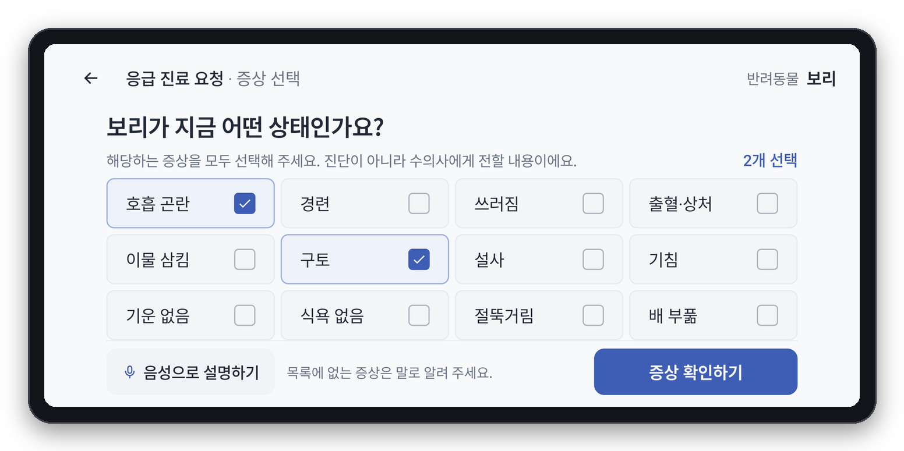
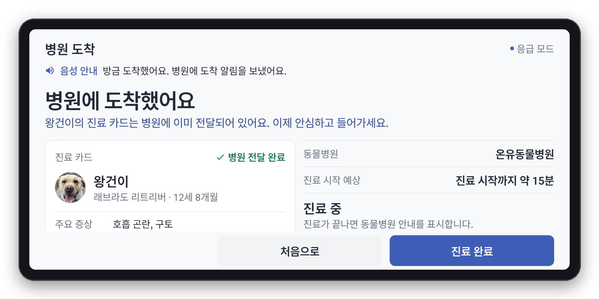
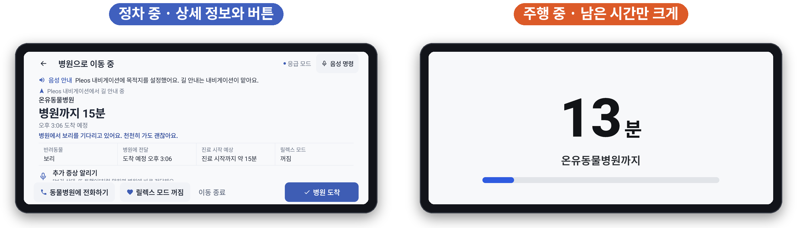
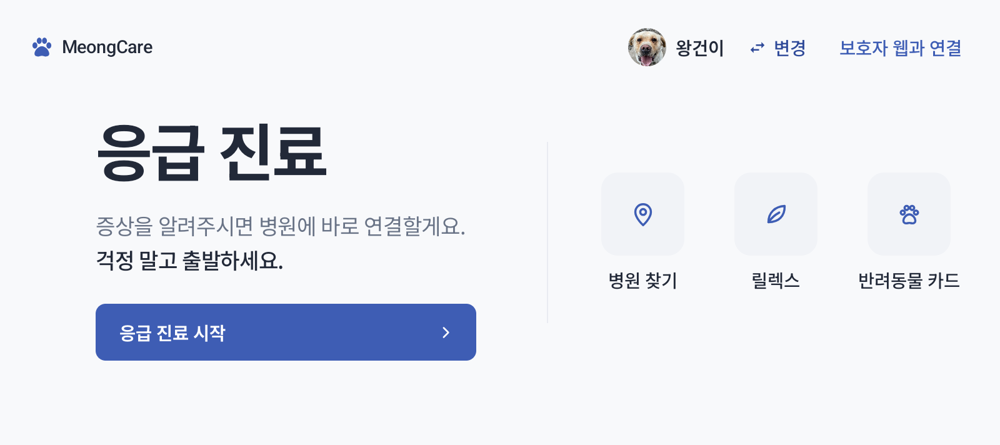
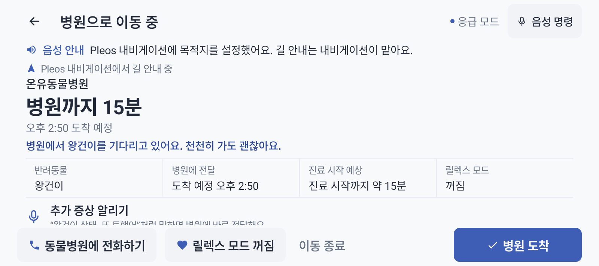
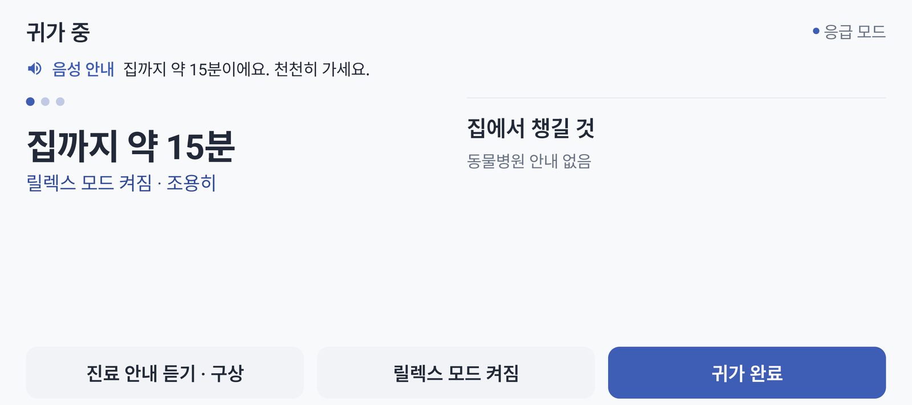

<p align="center"></p>

<h1 align="center">멍쾌 · MeongCare</h1>

<p align="center"><b>멍쾌는 반려동물의 응급 상황부터 일상 진료까지, 가장 빠른 진료 연결과 차량 기반 맞춤 케어를 통해<br>병원 이동 전·중·후의 모든 과정을 함께하는 AI 반려동물 헬스케어 코파일럿입니다.</b></p>

<p align="center">
  
  
  
  
  
  
</p>

<p align="center">
  <a href="#왜-멍쾌인가">왜 멍쾌인가</a> ·
  <a href="#핵심-기능">핵심 기능</a> ·
  <a href="#차량이라서-가능한-것">차량 특화</a> ·
  <a href="#서비스-생태계">서비스 생태계</a> ·
  <a href="#시연-범위">시연 범위</a>
</p>

<p align="center"></p>
<p align="center"><sub>응급 진료 시작 → 증상 선택 → 진료 카드 → 동물병원 응답 확인 → 출발 → 병원 도착 → 진료 완료 → 귀가</sub></p>

## 왜 멍쾌인가

> 반려견이 갑자기 아플 때, 보호자는 **운전하면서** 병원을 찾고, 진료가 가능한지 일일이 전화로 확인하고, 증상을 설명해야 합니다.
>
> **멍쾌는 이동 시간과 대기 시간을 함께 따져, 가장 가까운 병원이 아닌 가장 빨리 진료받을 수 있는 병원으로 안내합니다.**

## 핵심 기능

**1. 당황한 순간에도, 증상만 고르면 진료 카드 완성** — 큰 증상 카드를 누르기만 하면 반려견 정보와 합쳐져 병원에 보낼 진료 카드가 된다. 목록에 없는 증상은 말로 설명한다.

<p align="center"></p>

**2. 병원마다 전화 돌릴 필요 없이, 근처 동물병원에 한 번에 문의** — 20초 안에 답한 병원과 진료 불가 병원을 색으로 한눈에 보여 준다.

<p align="center"></p>

**3. 가장 가까운 곳이 아니라, 가장 빨리 진료받는 곳으로** — 이동 시간과 대기 시간을 합쳐 최적의 병원을 먼저 제안하고, 경로를 지도에 그린다.

<p align="center"></p>

**4. 도착했을 땐 이미 병원이 보리를 알고 있다** — 진료 카드가 먼저 가 있어 접수 설명이 필요 없고, 차 안에서 기다리다 진료 차례가 되면 알려 준다.

<p align="center"></p>

## 차량이라서 가능한 것

<p align="center"></p>

| Pleos SDK | 멍쾌에서 하는 일 |
|---|---|
| **Vehicle** · AAOS `CarUxRestrictions` | 주행 중엔 남은 시간만 크게, 정차 중에만 입력과 상세 화면 |
| **NaviHelper** | 고른 병원을 목적지로 설정, 길 안내는 차량 내비게이션이 |
| **SpeechToText** (`ON_DEVICE`) | 목록에 없는 증상은 말로 설명 |

차량 디스플레이(1682×1210) 기준으로 설계했다. 모든 SDK는 래퍼 뒤에 두고 Fake 구현을 함께 만들어 PC·테스트·시연 영상에서도 같은 흐름이 돈다.

## 사용 흐름

```
홈 ─▶ 증상 선택 ─▶ 진료 카드 확인 ─▶ 동물병원 응답 확인 (20초)
                                        ├─ 답한 병원 있음 ─▶ "○○으로 출발할까요?" ─┐
                                        └─ 답한 병원 없음 ─▶ 가장 가까운 병원 ────┤
                                                                                  ▼
     귀가 완료 ◀─ 귀가 중 ◀─ 진료 완료 ◀─ 병원 도착 ◀─ 병원으로 이동 중 ◀─ 출발 확인
```

<details>
<summary><b>나머지 화면 보기</b> (9장)</summary>

| 홈 · 응급 진료 | 진료 카드 확인 |
|---|---|
|  |  |
| **출발 확인** | **병원으로 이동 중** |
|  |  |
| **진료 완료** | **귀가 중** |
|  |  |
| **귀가 완료** | **반려동물 카드** |
|  |  |
| **릴렉스 모드** | |
|  | |

</details>

## 서비스 생태계

| | 하는 일 |
|---|---|
| **보호자 웹** (폰) | 반려동물 의료정보를 등록하고, 차 화면의 연결 코드로 차와 연결 |
| **멍쾌** (차) | 증상 → 병원 선택 → 이동 → 진료 → 귀가 |
| **병원 웹** | 대기 시간을 알리고, 진료 카드와 도착 예정을 실시간으로 받음 |

보호자 · 차 · 동물병원을 잇는 구조라서, 제휴 병원과 진료 기록이 쌓일수록 다음 이동이 더 빨라진다.

## 기술 구조

- **Android 앱**: Kotlin, Jetpack Compose(Material3), MVVM, 수동 DI. 단일 `app` 모듈.
- **웹**: React + Vite + TypeScript (보호자 웹 · 병원 웹).
- **서버**: Firebase (Firestore, 익명 로그인). 서버가 없어도 앱은 내장 데이터로 끝까지 돈다.
- **품질**: 단위 테스트(Android·웹), 커밋마다 빌드 확인, dev 반영 전 검증 파이프라인.
- 자세한 구조: [docs/architecture.md](docs/architecture.md)

## 시연 범위

출품작은 시연 환경에서 동작한다. 아래 항목은 **실제 서비스가 아니라 시연용**이다. 앱 화면에는 따로 표시하지 않는다.

| 항목 | 시연 내용 |
|---|---|
| 반려견 "보리" | 샘플 반려견이다. 사진·체중·특징은 정해 둔 값이다 (보호자 웹과 연결하면 등록한 정보로 바뀐다) |
| 시연 동물병원 | 가상 병원이다. 이름·거리·이동 시간·전화번호(`02-0000-002N`)는 실제가 아니다 |
| 병원 답변 · 진료 차례 호출 | 앱 안에서 정해 둔 시나리오로 온다. 병원 웹과 연결하지 않는다 |
| 진료 카드 전송 (시연 병원) | 앱 안에서만 보낸 것으로 처리한다 |
| 길 안내 | 차량 기기에서는 Pleos 내비가 실제 경로를 안내한다. 폰·태블릿에서는 시연용 길안내다. "병원 도착"은 버튼으로 처리한다 |
| 지도 | 실제 지도가 아니라 그린 그림이다 |
| 릴렉스 모드 | 설정 화면만 있다. 차량 공조·음악에는 적용하지 않는다 |
| 진료 기록 | 앱 메모리에만 저장한다. 보호자 웹 저장과 병원 전달은 아직 없다 |
| 음성 | 증상 음성 입력은 차량 기기에서만 실제로 듣는다. [음성 명령]·음성 안내 소리는 준비 중이다 |

더 자세한 내용: [docs/product/feature-facts.md](docs/product/feature-facts.md)

---

# <앱 이름>

> <한 줄 소개>

2026 현대자동차그룹 차량용 앱 개발 공모전 출품작 · Pleos Connect

## 실행 방법

1. Pleos Connect 에뮬레이터를 설치한다. ([docs/pleos/emulator-setup.md](docs/pleos/emulator-setup.md))
2. 에뮬레이터를 **Cold boot**로 실행한다.
3. APK를 설치한다:

   ```
   adb install -r apk/<팀명>_<앱이름>_release.apk
   ```

4. 런처에서 `<앱 이름>`을 실행한다. release APK는 **시연 모드**로 켜진다 (아래).

> **가장 빨리 진료받을 병원**: 진료 카드에서 [가장 빨리 진료받을 곳 찾기]를 누르면 제휴 병원을 "이동 시간 + 병원이 알린 대기 시간"이 짧은 순으로 보여 준다. 이동 시간은 현재 위치에서의 직선 거리로 어림한 값이다. 병원 5곳과 대기 시간은 모두 **시연용 가상 데이터**이고, release APK는 서버 없이 이 데이터로 끝까지 돈다. 앱 화면에도 그렇게 표시한다. (debug 빌드 + 로컬 서버에서는 지금 위치 근처의 실제 동물병원도 함께 보인다. 아래 "근처 동물병원".)
> **길안내**: 차량 기기(Pleos 에뮬레이터·실차)에서는 병원을 고르고 [출발]을 누르면 **차의 내비게이션(Pleos NaviHelper)이 병원까지 실제 경로 안내를 시작**한다. 앱의 남은 시간은 내비 예상 시간에서 시작해 주행 중에 시연용으로 줄고 도착한다 (에뮬레이터에서는 내비 속 차가 움직이지 않아 진짜 도착이 오지 않기 때문). 시연 도착 때 앱은 화면에 남고 내비 경로는 그대로 둔다 (경로를 취소하면 내비 앱이 앞으로 나와 "도착했어요"를 가린다. 다음 출발이 새 경로로 바꾼다). 일반 폰 에뮬레이터에서는 내비 없이 시연용 길안내만 돈다. 
> **반려견 정보와 병원 번호도 시연용이다.** 제출 APK는 서버 설정이 없어 보호자 웹과 연결하지 않고, 샘플 반려견 "보리"의 정보로 진료 카드를 만든다 (보호자 웹 연결은 아래 "보호자 웹"의 로컬 서버 시연). 병원 번호 `02-0000-000N`은 걸리지 않는 번호이고, [병원에 전화]는 전화 앱을 열기만 한다 (걸지 않는다). 앱 화면에도 그렇게 표시한다.
> 주행/정차는 차량 기기(Pleos 에뮬레이터)에서 실제 주행 규제 값(AAOS `CarUxRestrictions`)을 따른다.

## 테스트 환경 및 필요 설정

- 확인한 환경: Pleos Connect Emulator v2.1.0 (Android API 34), 일반 폰 에뮬레이터 (Android API 34). 그 밖의 환경은 확인하지 않았다.
- 계정 설정과 권한 허용은 필요 없다. 일반 폰·태블릿(차량 기기가 아닌 곳)은 현재 위치를 **서울 서초구 서운로 62(화면 이름 "서초동")로 고정**한다 (시연용, 계획 016). 차량 기기(Pleos 에뮬레이터)는 내비 위치를 쓴다.

### Pleos 에뮬레이터에서 시연하기 (기어로 주행·정차 바꾸기)

1. 에뮬레이터를 **Cold boot**로 켜고 앱을 실행한다. 정차(P) 상태라 정차 화면이 보인다.
2. Virtual Console을 연다: `adb forward tcp:8088 tcp:8088` → PC 브라우저로 `http://127.0.0.1:8088/` → Emulation Controls → Motion → Gear Selection. ([docs/pleos/emulator-setup.md](docs/pleos/emulator-setup.md) "Virtual Console")
3. 앱에서 **[진료 카드 만들기]** → 증상을 큰 버튼으로 고른다 (예: 호흡 곤란, 기침) → **[카드 만들기]** → 진료 카드: 고른 증상 + 등록된 기존 병력·알레르기·복용 약물.
   - [수정]은 증상 다시 고르기, [홈]은 카드를 둔 채 처음 화면으로 (처음 화면의 [카드 보기]로 돌아온다).
   - **증상을 말로 고를 수도 있다** (정차 중에만): 증상 고르기 화면 위쪽 **[말로 증상 고르기]** → 한 문장으로 말한다 (예: "강아지가 갑자기 토하고 숨을 가쁘게 쉬어요") → 알아들은 말과 찾은 증상이 보이고, 그 증상 버튼이 눌린다. 버튼으로 고칠 수 있다.
     - Pleos SpeechToText `ON_DEVICE`(기기 안의 음성 엔진)로 받아쓰고, 키워드 규칙으로 증상을 찾는다. 네트워크와 로그인은 필요 없다.
     - 에뮬레이터에 PC 마이크 소리가 들어가야 한다: 에뮬레이터를 `-allow-host-audio`로 켜고, 에뮬레이터를 켠 앱에 PC 마이크 권한을 준다 ([docs/pleos/emulator-setup.md](docs/pleos/emulator-setup.md) "에뮬레이터 마이크 (Mac)"). 말이 없으면 15초 뒤 "말소리를 듣지 못했어요"가 나온다.
4. **[가장 빨리 진료받을 곳 찾기]** → 병원 목록: 1위 "시연용 바른 동물병원 약 29분 (이동 약 19분 + 대기 10분)", 2위 "시연용 동물병원 약 40분", 3위 "시연용 가까운 동물병원 약 69분"(가장 가깝지만 대기 60분). 대기 정보가 지난 곳과 응급 접수를 받지 않는 곳은 따로 보인다.
   - 위치를 아직 모르면(에뮬레이터를 켠 뒤 내비 화면을 한 번도 안 띄웠을 때) 대기 시간 순으로 보이고 [위치 다시 찾기]가 있다.
5. 1위를 누르면 확인 화면: 보내는 것(반려견 정보·증상·병력·알레르기·복용 약·도착 예정)과 보내지 않는 것(사진, 차 위치). [병원에 전화] [카드 없이 길안내만] [출발].
6. **[출발]** → 차의 내비 앱이 앞에 나와 그 병원 경로를 계산하고 안내를 시작한다 (10~20초). GNB의 MeongCare 아이콘으로 돌아오면 진료 카드 위에 **안내 영역**: "시연용 바른 동물병원까지", 큰 남은 분, 도착 예정 시각, 출발 때 알린 대기, 진행 막대, "시연용: 실제 병원에는 보내지 않았어요"(서버 없는 release). P에 있는 동안에는 남은 시간이 줄지 않는다.
7. Virtual Console에서 기어를 **D**로 → 앱이 주행 화면으로 바뀐다: **아주 큰 남은 분 + "○○까지" + 진행 막대**만 (주행 중에는 버튼·카드·증상 고르기를 보이지 않는다). 중간에 P로 바꾸면 멈추고 카드가 다시 보인다.
8. 남은 시간이 다 지나면 주행 화면에 "도착했어요" (앱이 앞에 남는다) → 기어를 **P**로 → 초록 "시연용 바른 동물병원에 도착했어요 · 이 카드를 접수처에 보여 주세요" + 같은 진료 카드. 수의사에게 보여 주는 화면이다. [닫기]로 처음 화면에 돌아간다.
   - 안내 중 [안내 취소]를 누르면 내비 경로가 취소되고 내비 앱이 앞에 나온다 (앱이 스스로 돌아올 수 없다. GNB의 MeongCare 아이콘으로 돌아온다).

### 일반 폰·태블릿 에뮬레이터에서 시연하기

- 차량 기기가 아니라서 주행 상태도 가짜로 흉내 낸다.
- 앱에서 **[진료 카드 만들기]** → 증상 고르기 → **[카드 만들기]** → **[가장 빨리 진료받을 곳 찾기]** → 병원 → **[출발]**을 누르면 출발(주행 화면) → 남은 시간 감소 → 도착 → 주차("도착했어요" 진료 카드)가 저절로 이어진다 (약 30초).
- 증상 고르기 화면의 **[말로 증상 고르기]**는 차량 기기가 아니라서 실제로 듣지 않고, 예시 문장 3개를 차례로 받아쓴다. 화면에 "시연용 음성 입력이에요"라고 표시한다.

## 보호자 웹 (선택)

보호자가 폰 브라우저에서 반려견 프로필과 의료정보(주요 질환, 알레르기, 복용 약)를 미리 등록하는 웹이다. 소스는 [`web/`](web/)에 있다.

> **서버 설정 없이 열면 정보는 그 브라우저에만 저장되고 차와 연결할 수 없다.** 웹 화면에도 그렇게 표시한다.
> PC의 Firebase 에뮬레이터에 붙이면(아래 "보호자 웹과 차 연결") 서버 저장에 동의한 뒤 차 화면의 6자리 코드로 차와 연결해, 차의 진료 카드에 등록한 정보가 들어간다.

1. Node.js 22.12 이상을 설치한다.
2. 저장소 루트에서:

   ```
   npm --prefix web ci
   npm --prefix web run dev
   ```

3. 브라우저로 `http://localhost:5173`을 연다. 폰 크기로 보려면 개발자 도구(F12)의 기기 모드를 켠다.

### 근처 동물병원 (로컬 서버 시연, 계획 015)

지금 위치에서 5km 안의 **실제 동물병원**을 카카오 로컬 API로 찾아 제휴 병원과 한 목록에 섞는다. debug 빌드 + PC의 Firebase 에뮬레이터에서만 된다 (release APK는 제휴 병원만).

1. [firebase/README.md](firebase/README.md) "근처 동물병원 함수": 카카오 REST 키를 `firebase/functions/.secret.local`에 넣고 `npm --prefix firebase run emulators:nearby` → `seed -- --reset` → `preflight -- --nearby --fix`.
2. 차 앱 debug 빌드 (`secrets.properties`에 에뮬레이터 값), debug 패널에서 **시연** 모드.
3. 위치는 넣지 않아도 된다. 일반 폰·태블릿은 서초동(서운로 62)으로 고정돼 있다 (계획 016). 차량 기기(Pleos 에뮬레이터)는 내비 위치(기본 시흥동).
4. 진료 카드 → **[가장 빨리 진료받을 곳 찾기]** → 제휴 병원과 근처 동물병원이 "이동 + 대기"가 짧은 순으로 **5개씩** ([이전]/[다음]).
   - 근처 병원의 대기 시간은 **시연용 예시**다. 줄마다 "대기 N분(예시)", 목록 위에 "근처 병원 장소 정보: 카카오 · 대기 시간은 시연용 예시예요".
   - 근처 병원을 누르면 [병원에 전화]·[길 안내 시작]만 있다. 제휴 병원이 아니라 진료 카드는 보내지 않는다.
   - 현재 위치(약 100m 단위)를 우리 함수 → 카카오로 보내고, 결과는 저장하지 않는다.

### 보호자 웹과 차 연결 (로컬 서버 시연, 계획 014)

1. Firebase 에뮬레이터를 켜고 시드한다 ([firebase/README.md](firebase/README.md)). 시연 직전 `npm --prefix firebase run preflight -- --fix`.
2. `web/.env.local`에 에뮬레이터 값을 넣고(`web/.env.example`의 처음 세 줄) `npm --prefix web run dev` → 폰 크기로 `http://127.0.0.1:5173/`.
3. 반려견을 등록하면 프로필 아래에 **[차와 연결하기]** 카드가 생긴다. 누르면 처음 한 번 동의 화면 → **[동의하고 연결하기]** → 바로 코드 입력 화면 (브라우저에 있던 정보는 서버로 옮기고 브라우저에서 지운다).
4. 차 앱 debug 빌드(시연 모드, `secrets.properties`에 에뮬레이터 값)의 처음 화면에서 **[보호자 웹과 연결]** → 큰 6자리 코드.
5. 보호자 웹 코드 입력 화면에 코드 입력 → 차에 "○○ 보호자와 연결했어요" → 진료 카드와 병원에 보내는 카드에 그 반려견 정보가 들어간다. 보호자 웹 카드는 "차와 연결됨"으로 바뀐다 (차에서 끊으면 바로 돌아온다).
   - 연결 화면은 정차 중에만 보이고 차에서는 글자를 입력하지 않는다. 코드는 10분 동안 한 번만 쓸 수 있다.
   - 차 처음 화면의 **[연결 끊기]**로 끊는다. 앱을 다시 켜면 다시 연결해야 한다 (지금 범위).

- 확인한 환경: Chromium (Playwright), 폰 크기 390×844·360×800. Safari와 실제 폰은 확인하지 않았다.
- 자세한 실행·확인 방법: [web/README.md](web/README.md)

## 병원 웹 (선택, 시연용)

제휴 병원 직원이 예상 대기 시간·혼잡도·응급 접수를 알리고, 차에서 보낸 진료 카드를 실시간으로 보는 화면이다 (`web/`의 `/hospital/`).

- 서버 없이: `npm --prefix web run dev` → `http://localhost:5173/hospital/`. 이 브라우저에서만 동작하고 예시 환자 1건이 보인다.
- 차 앱과 연결 (PC의 Firebase 에뮬레이터, Java 21 필요): [web/README.md](web/README.md) "로컬 에뮬레이터에 붙여 보기"와 [firebase/README.md](firebase/README.md). debug 빌드에서만 된다. release APK는 서버 없이 시연용 병원으로 돈다.
  - 차가 [출발]하면 진료 카드가 "새 환자"로 강조되어 뜨고, 남은 시간이 몇 초마다 바뀐다. 병원이 **[카드 확인]**을 누르면 차 화면(주행 중 포함)에 "병원이 카드를 확인했어요"가 뜬다.
  - 시연 직전에 `npm --prefix firebase run preflight -- --fix`로 서버·adb reverse·대기 정보를 점검하고, 고칠 수 있는 것은 고친다. 병원 웹 위의 "서버:" 줄이 `127.0.0.1:8080 … 실시간 연결됨`인지 본다.

## APK

- [`apk/<팀명>_<앱이름>_release.apk`](apk/)
- 용량 문제로 Release에 올린 경우: <Release 링크>

## 소스에서 빌드하기

Android Studio 없이 Gradle wrapper만으로 빌드된다.

1. 준비물
   - JDK 17 이상 (JDK 21에서 확인함)
   - Android SDK Platform 35, Build-Tools 35
   - `ANDROID_HOME` 환경 변수, 또는 저장소 루트 `local.properties`의 `sdk.dir`
2. (선택) Pleos Client ID/Secret이 필요한 기능(TTS/STT)을 쓸 때만 `secrets.properties.example`을 복사해 `secrets.properties`를 만든다. 없어도 빌드된다.
3. 빌드, 단위 테스트, 린트:

   ```
   ./gradlew assembleDebug
   ./gradlew testDebugUnitTest
   ./gradlew lintDebug
   ```

   Windows PowerShell에서는 `.\gradlew.bat`을 쓴다.
4. debug 빌드는 **Fake 모드**로 시작한다. 차량 없이 가짜 데이터로 동작한다.
   - 화면 아래 debug 패널로 주행 상태(정차/주행/모름)를 바꾼다.
   - 같은 패널의 버튼을 누를 때마다 Fake → 시연 → Real 모드로 바뀐다. 앱이 다시 시작된다.
   - release 빌드는 항상 **시연 모드**다. 구성표: [docs/architecture.md](docs/architecture.md) "데이터 모드".

## 팀

- <이름 / 역할>

---

## 팀원 개발 가이드

이 저장소에는 Claude Code 하네스가 설정돼 있다. 규칙, 훅, 스킬, 서브에이전트로 이루어져 있다.
평소에는 Claude Code에 하고 싶은 일을 말로 시키면 되고, 아래 규칙은 훅이 대부분 자동으로 지킨다.

### 처음 한 번

1. clone한 뒤 dev 브랜치로 옮긴다. clone하면 main만 받아지기 때문이다.

   ```
   git switch dev
   ```

2. 저장소 이름이 바뀌기 전에 clone했다면 원격 주소를 바꾼다.

   ```
   git remote set-url origin https://github.com/Hyundai2026/meongcare-hmg-challenge.git
   ```

3. Node.js를 설치한다. 훅이 node로 동작한다.
4. 이 폴더를 Claude Code로 연다. 세션이 시작되면 git 훅(`core.hooksPath=.githooks`)이 자동으로 켜진다.
   - Claude Code 없이 터미널만 쓴다면 직접 켠다: `git config core.hooksPath .githooks`
5. (선택) 다이어그램 스킬(`/stack-diagram`)을 쓰려면 Python 3.9 이상과 Playwright가 필요하다.

   ```
   pip install playwright && python -m playwright install chromium
   ```

6. 기획 도구 BMAD를 쓰려면 [uv](https://docs.astral.sh/uv/)와 Python 3.10 이상이 필요하다.
   - BMAD가 나를 이름으로 부르게 하려면 `_bmad/custom/config.user.toml`을 만들어 아래처럼 쓴다. 이 파일은 커밋되지 않는다.

     ```
     [core]
     user_name = "이름"
     ```

### 브랜치

| 브랜치 | 역할 | 바뀌는 방법 |
|---|---|---|
| `main` | 제출·시연용. 심사위원이 보는 기본 브랜치 | 제출·PT 전에 `/promote`로만 |
| `dev` | 평소 작업이 모이는 곳 | 작업 브랜치를 `/ship`으로 반영 |
| `feat/*`, `fix/*` 등 | 작업 하나 | 여기서만 커밋 |

### 개발 순서

1. Claude Code에 하고 싶은 일을 말한다. 예: "차속 표시 기능 만들어줘"
2. Claude가 아래 순서로 진행한다.

   ```
   dev에서 브랜치 따기 → 계획(planner) → 구현(단위마다 자동 커밋) → 테스트(tester)
   → 화면 확인(/verify) → 개발 노트 → /ship으로 dev에 반영
   ```

3. **push 승인 창이 뜨면 승인한다.** 사람이 할 일은 이것뿐이다.
4. 제출이나 PT 전에는 `/promote`를 입력해 main에 올린다. 예: `/promote 11/15 제출`

### 명령어

| 명령 | 언제 | 누가 |
|---|---|---|
| `/promote` | dev를 main에 올릴 때 (제출·PT 전) | **직접 입력해야만 동작** |
| `/release-apk` | 제출용 APK를 만들 때 | **직접 입력해야만 동작** |
| `/ship` | 작업 브랜치를 dev에 반영할 때 | 보통 Claude가 실행. 직접 입력해도 됨 |
| `/verify` | 빌드한 앱을 에뮬레이터에서 스크린샷으로 확인할 때 | 보통 Claude가 실행 |
| `/stack-diagram` | 기술 스택·아키텍처 그림이 필요할 때 (기획서, PT). 예: "우리 앱 구조도 그려줘" | 말로 시키면 Claude가 실행. 공개 갤러리에는 올리지 않는다 |
| `/bmad-help` 등 BMAD 스킬 | 기획할 때: 브레인스토밍 → 제품 개요 → PRD → UX → 아키텍처. 예: "bmad로 아이디어 브레인스토밍 하자" | 말로 시키거나 직접 입력. 개발 단계 BMAD 스킬은 꺼 두었다. 사용법: [docs/product/bmad-guide.md](docs/product/bmad-guide.md) |

### 규칙

**Git**

- main과 dev에는 직접 커밋하지 않는다. 작업 브랜치는 원격에 push하지 않는다.
- PR은 쓰지 않는다.
  - 대신 검증 파이프라인(Android `assembleDebug testDebugUnitTest lintDebug` + 보호자 웹 `npm --prefix web run check`)을 통과해야 dev나 main에 push된다.
  - 보호자 웹 의존성이 없으면 파이프라인이 멈춘다. `npm --prefix web ci`를 한 번 실행한다.
  - `--no-verify`와 force push는 쓰지 않는다.
- 커밋은 작게, 한 커밋에 한 가지 이유만 담는다.
  - 메시지 형식은 `type(scope): 요약`이다. 예: `feat(vehicle): 차속 Flow 래퍼 추가`
- 커밋 메시지에 Claude 트레일러(`Co-Authored-By: Claude`)를 넣지 않는다. 훅이 자동으로 막는다.

**작업 기록**

- 작업이 끝나면 개발 노트를 `docs/notes/<git user.name>/YYYY-MM-DD-<작업>.md`에 남긴다.

**앱 개발**

- Pleos API는 추측하지 않는다. `docs/pleos/sdk-notes.md`에 있는 것만 쓴다.
- 새 `pleos.car.permission.*` 권한은 먼저 팀에서 확인한다.
- 비밀값(`secrets.properties`, `keystore.properties`, `*.jks`)은 커밋하지 않는다.

### Claude Code 없이 직접 할 때

```
git switch dev && git pull --ff-only
git switch -c feat/<이름>
# 작업하고 작게 커밋

# dev에 반영 (/ship과 같은 순서)
git fetch origin && git rebase origin/dev
node .claude/hooks/build-gate.mjs pipeline
git switch dev && git merge --ff-only origin/dev
git merge --no-ff --no-edit feat/<이름>
git push origin dev
git branch -d feat/<이름>
```

- push가 거절되면 다른 팀원이 먼저 push한 것이다.
- 이때는 `git reset --keep HEAD^`로 로컬 merge만 되돌리고 `git fetch`부터 다시 한다.

### 더 자세한 문서

| 문서 | 내용 |
|---|---|
| [AGENTS.md](AGENTS.md) | 프로젝트 규칙 전체 (에이전트와 사람 공통) |
| [CLAUDE.md](CLAUDE.md) | Claude Code 작업 흐름, 훅, 서브에이전트 |
| [docs/conventions/git.md](docs/conventions/git.md) | 브랜치, 커밋, `/ship`, `/promote` 상세 |
| [docs/notes/README.md](docs/notes/README.md) | 개발 노트 템플릿 |
