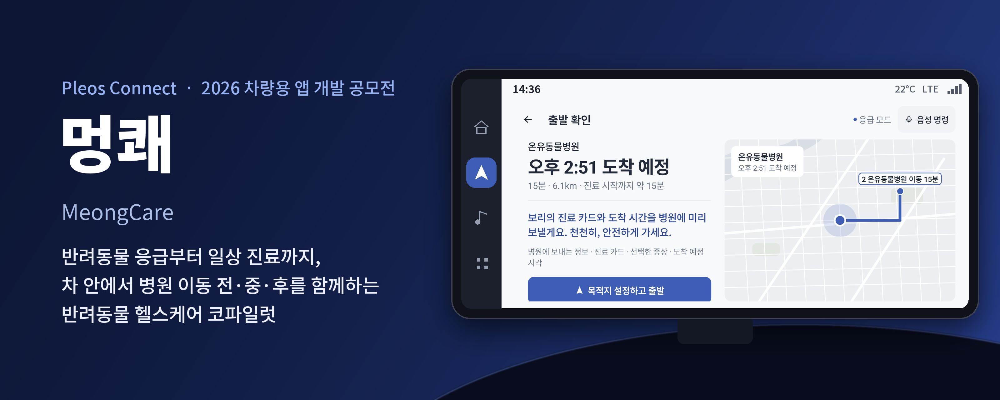
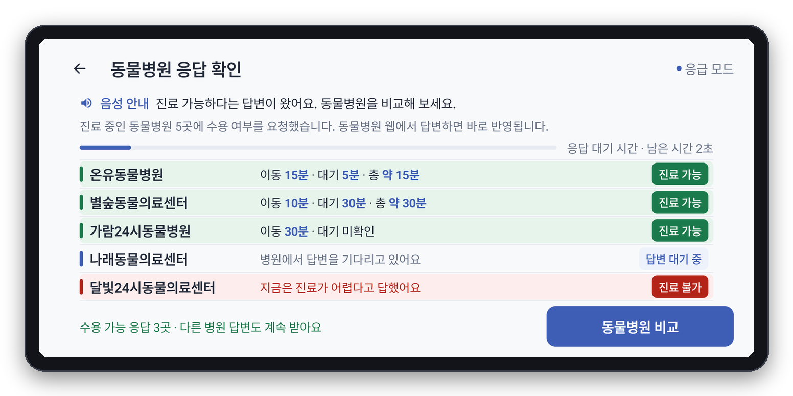
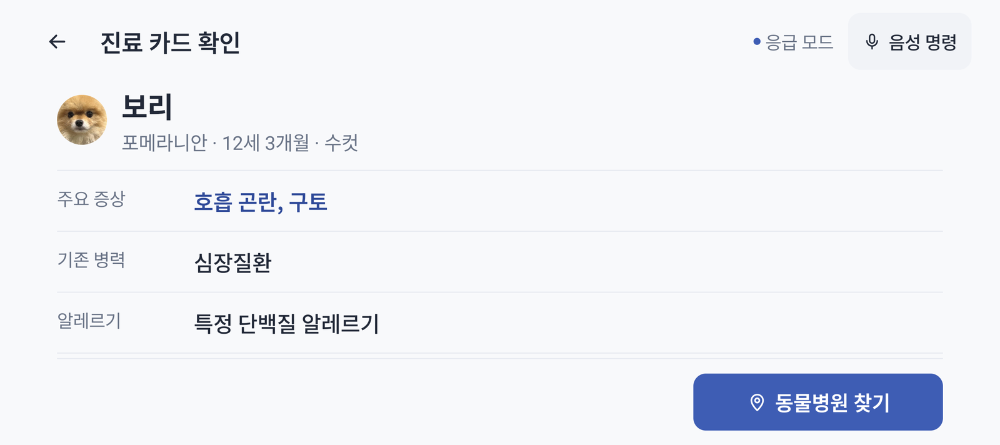
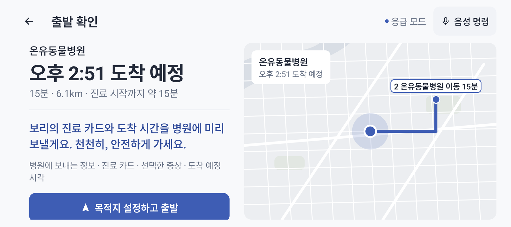
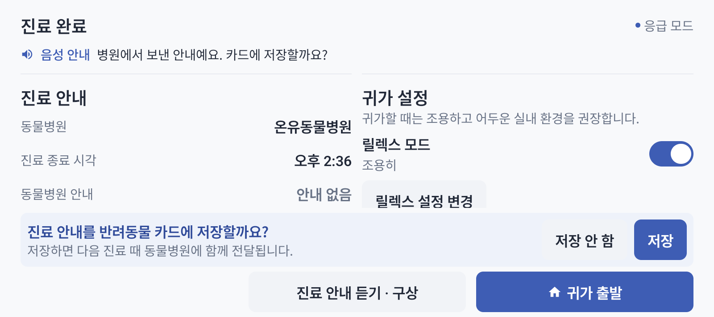
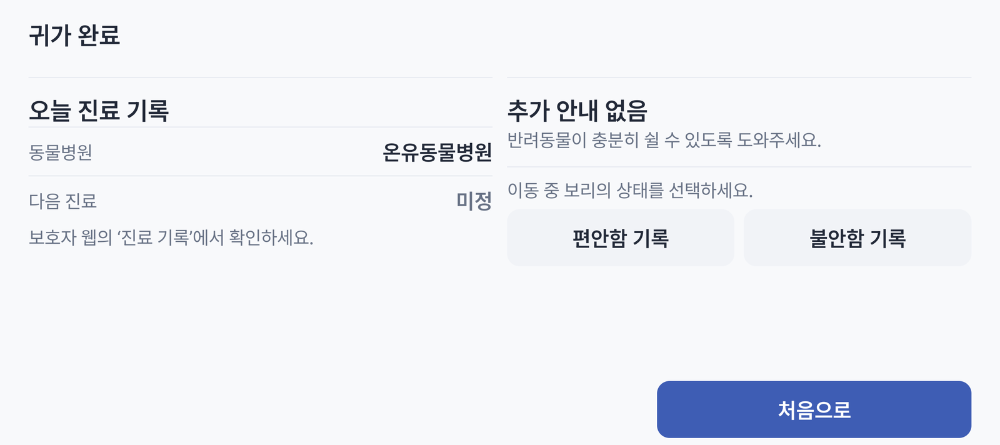
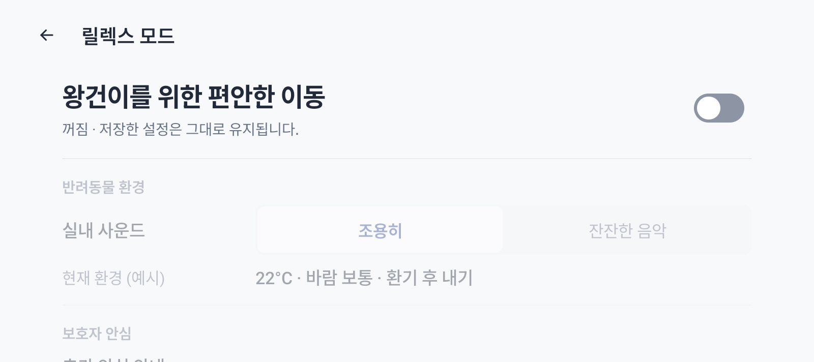
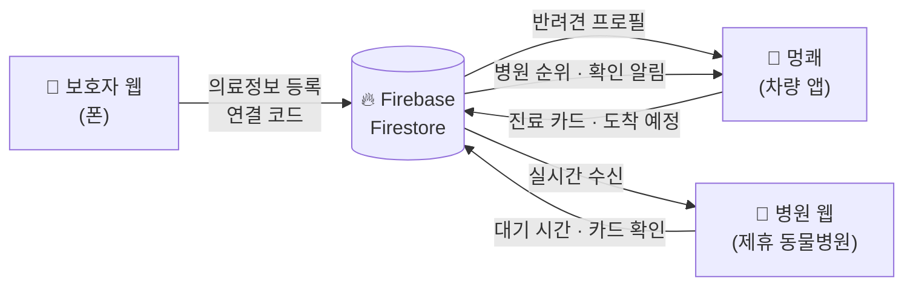
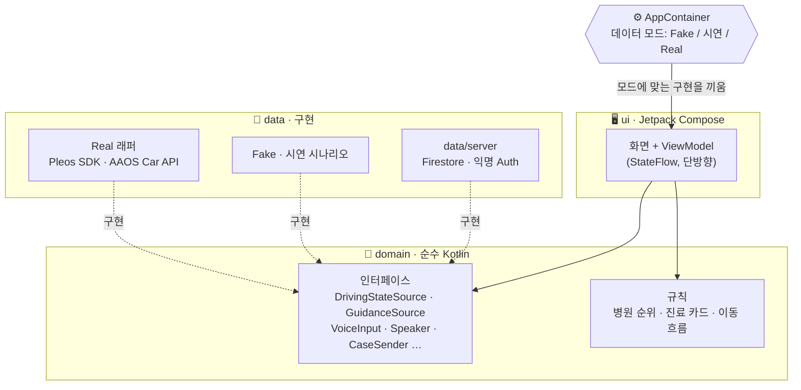

<div align="center">



# 멍쾌 · MeongCare

**반려동물의 응급 상황부터 일상 진료까지, 가장 빠른 진료 연결과 차량 기반 맞춤 케어로<br>병원 이동 전·중·후를 함께하는 반려동물 헬스케어 코파일럿**

<sub>2026 현대자동차그룹 차량용 앱 개발 공모전 출품작 · Team **P2V (Pet to Vet)**</sub>

<br>


<a href="#-주요-기능">주요 기능</a> ·
<a href="#-화면">화면</a> ·
<a href="#-차량이라서-가능한-것">차량이라서 가능한 것</a> ·
<a href="#-기술-스택">기술 스택</a> ·
<a href="#-기술적-포인트">기술적 포인트</a> ·
<a href="#-실행-가이드">실행 가이드</a> ·
<a href="#-팀">팀</a>

<br><br>


<sub>응급 진료 시작 → 증상 선택 → 진료 카드 → 동물병원 응답 확인 → 출발 → 병원 도착 → 진료 완료 → 귀가</sub>

</div>

<br>

## ✨ 주요 기능

### 1. 증상만 고르면 진료 카드 완성

당황한 순간에도 큰 증상 카드를 누르기만 하면, 반려견 정보와 합쳐져 병원에 보낼 **진료 카드**가 됩니다. 목록에 없는 증상은 **말로** 설명합니다.

<p align="center"></p>

### 2. 근처 동물병원에 한 번에 문의

병원마다 전화할 필요 없이 근처 병원 5곳에 동시에 묻습니다. **20초 안에 답한 병원**과 진료 불가 병원을 색으로 한눈에 보여 줍니다.

<p align="center"></p>

### 3. 가장 가까운 곳이 아니라, 가장 빨리 진료받는 곳으로

**이동 시간 + 대기 시간**을 합쳐 실제로 가장 빨리 진료받을 수 있는 병원을 먼저 제안하고, 차량 내비게이션으로 바로 안내합니다.

<p align="center"></p>

### 4. 도착했을 땐 병원이 이미 우리 아이를 압니다

출발하면 진료 카드와 도착 예정 시간이 병원으로 먼저 갑니다. 접수 설명이 필요 없고, **차 안에서 기다리다 진료 차례가 되면** 알려 줍니다.

<p align="center"></p>

### 전체 기능 한눈에

| 흐름 | 기능 | 설명 |
|:---:|---|---|
| 미리 | **의료정보 등록** (보호자 웹) | 폰에서 반려견 의료정보를 등록하고, 차 화면의 **6자리 연결 코드**로 차와 연결합니다. 차에서는 글자를 입력하지 않습니다 |
| 응급 | **증상 → 진료 카드** | 12가지 증상 카드 + 음성 입력으로 진료 카드를 만듭니다 |
| 응급 | **동물병원 동시 문의** | 근처 병원 5곳에 한 번에 묻고 20초 동안 응답을 모읍니다 |
| 선택 | **가장 빨리 진료받을 병원** | 이동 시간과 병원이 알린 대기 시간을 합쳐 순위를 매깁니다 |
| 이동 | **길 안내 + 카드 자동 전송** | Pleos 내비로 안내하고, 주행 중에는 남은 시간만 크게 보여 줍니다 |
| 도착 | **차 안 대기 · 진료 차례 알림** | 대기실 대신 차 안에서 기다리다 차례가 되면 알림을 받습니다 |
| 진료 후 | **진료 기록 · 귀가 안내** | 진료 기록을 남기고 집까지 길 안내로 마무리합니다 |
| 일상 | **반려동물 카드 · 릴렉스 모드** | 반려견 정보를 한 장으로 보고, 함께 이동할 때의 차 안 환경을 설정합니다 |
| 병원 | **병원 웹** | 제휴 병원이 대기 시간을 알리고, 진료 카드와 도착 예정을 실시간으로 봅니다 |

> 현재 출품작에서 실제로 동작하는 범위와 시연용으로 정해 둔 부분은 [시연 범위](#-시연-범위)에 정리했습니다.

## 📱 화면

| 홈 · 응급 진료 | 진료 카드 확인 | 출발 확인 |
|:---:|:---:|:---:|
|  |  |  |
| **병원으로 이동 중** | **진료 완료** | **귀가 중** |
|  |  |  |
| **귀가 완료** | **반려동물 카드** | **릴렉스 모드** |
|  |  |  |

## 🚗 차량이라서 가능한 것

<p align="center"></p>

| Pleos SDK | 멍쾌에서 하는 일 |
|---|---|
| **Vehicle** · AAOS `CarUxRestrictions` | 주행 중엔 남은 시간만 크게, 정차 중에만 입력과 상세 화면 |
| **NaviHelper** | 고른 병원을 목적지로 설정, 길 안내는 차량 내비게이션이. 현재 위치·도착 예정 시간도 여기서 받습니다 |
| **SpeechToText** (`ON_DEVICE`) | 목록에 없는 증상은 말로 설명. 차 안 음성 엔진이라 네트워크가 필요 없습니다 |

차량 디스플레이(1682×1210) 기준으로 설계했습니다.

### 서비스 생태계



보호자 · 차 · 동물병원을 잇는 구조라서, 제휴 병원과 진료 기록이 쌓일수록 다음 이동이 더 빨라집니다.

## 🛠 기술 스택


-3DDC84?style=flat-square&logo=android&logoColor=white)


<details open>
<summary><b>📋 분류별로 보기</b></summary>
<br>

| 분류 | 사용 기술 | 버전 |
|---|---|---|
| 플랫폼 | Pleos Connect (AAOS) | 에뮬레이터 v2.1.0, Android API 34 |
| Pleos SDK | Vehicle · NaviHelper · SpeechToText(`ON_DEVICE`) · TextToSpeech(`ON_DEVICE`, 준비 중) | `Vehicle:2.3.2` · `NaviHelper:3.0.5` · `SpeechToText:3.3.1` · `TextToSpeech:3.3.1` |
| AAOS | `CarUxRestrictionsManager` (주행·정차 판단) | |
| Pleos 권한 | `NAVI_ROUTE_SEARCH` · `NAVI_ROUTE` · `STT_SERVICE` · `TTS_SERVICE` | |
| Android 앱 | Kotlin · Jetpack Compose + Material3 · MVVM(ViewModel + StateFlow) · 수동 DI | Kotlin 2.0.0, AGP 8.8.2, Gradle 8.10.2, minSdk 28 / target 35 |
| 웹 | React · Vite · TypeScript (보호자 웹 · 병원 웹) | `web/package.json`에 정확히 고정 |
| 서버 | Firebase Firestore · 익명 Auth · 보안 규칙 | `firebase/package.json`에 고정 |
| 테스트 · CI | JUnit4 · kotlinx-coroutines-test · Turbine · Vitest · GitHub Actions | |

</details>

<details open>
<summary><b>🧭 아키텍처</b></summary>
<br>



**폴더 구조** (`app/src/main/java/com/meongcare/app`)

```
ui/        화면과 ViewModel (home, card, hospital, trip, visit, pet, relax, link, debug …)
domain/    인터페이스와 규칙. Android·SDK를 모른다
data/      SDK 래퍼(Real)와 Fake, 서버 통신(data/server)
di/        AppContainer와 데이터 모드별 구성
```

자세한 구조와 결정 근거: [docs/architecture.md](docs/architecture.md)

</details>

## 💡 기술적 포인트

- **주행 상태에 반응하는 화면** — 기어나 속도가 아니라 AAOS `CarUxRestrictions`의 규제 값으로 주행·정차를 판단합니다. 주행 중에는 남은 시간 같은 최소 정보와 큰 버튼만, 입력과 상세 화면은 정차 중에만 보여 줍니다.
- **SDK 래퍼 + Fake, 세 가지 데이터 모드** — Pleos SDK와 Car API는 `data/` 래퍼에서만 부르고, 화면은 `domain/` 인터페이스만 봅니다. 래퍼마다 Fake를 함께 만들어 `AppContainer`가 **Fake / 시연 / Real** 모드로 바꿔 끼웁니다. 덕분에 GPU 없는 PC, 단위 테스트, 시연 영상에서도 같은 흐름이 돕니다.
- **콜백을 코루틴으로** — SDK의 `onComplete`/`onFailed` 콜백을 래퍼 안에서 `suspend` 함수와 `Flow`로 감싸, 화면 쪽은 StateFlow 하나로 상태를 그립니다.
- **"가장 빨리 진료받는 곳" 순위** — 이동 시간 어림(직선 거리 기반)과 병원이 알린 대기 시간을 합쳐 정렬합니다. 대기 정보가 오래됐거나 없으면 뒤로 보내 잘못된 추천을 막습니다.
- **차에서 글자 입력 없이 폰과 연결** — 차가 정차 중 6자리 코드를 보이고 보호자가 폰에서 입력하는 TV 로그인 방식입니다. 코드는 10분 동안 한 번만 쓸 수 있고, 의료정보는 차 기기에 저장하지 않습니다.
- **서버가 없어도 끝까지 동작** — 서버 통신은 `data/server` 한 곳에만 있고, 설정이 없으면 내장 시연 병원으로 전체 흐름이 끝까지 돕니다. 익명 인증 토큰은 만료 전에 미리 갱신합니다.
- **품질 관리** — Android JVM 단위 테스트 1,500개 이상, 웹 Vitest, Firestore 보안 규칙 점검 스크립트. 커밋마다 빌드를 확인하고, dev에 합치기 전 빌드·테스트·린트·웹 검사 파이프라인을 통과해야 합니다 (GitHub Actions에서도 같은 검사).

## 🎬 시연 범위

출품작은 시연 환경에서 동작합니다. 아래 항목은 **실제 서비스와 연동하지 않고, 정해 둔 데이터와 시나리오로 동작**합니다. 앱 화면에는 따로 표시하지 않습니다.

<details>
<summary><b>시연용으로 정해 둔 항목 보기</b></summary>
<br>

| 항목 | 시연 내용 |
|---|---|
| 반려견 "왕건이"·"오숑이" | 샘플 반려견 두 마리입니다. 정차 중 홈의 [⇄ 변경]으로 바꿉니다. 사진·품종·체중·특징·의료정보는 정해 둔 값입니다 (보호자 웹과 연결하면 등록한 정보로 바뀝니다) |
| 시연 동물병원 | 가상 병원입니다. 이름·거리·이동 시간·전화번호(`02-0000-002N`)는 실제가 아닙니다 |
| 병원 답변 · 진료 차례 호출 | 앱 안에서 정해 둔 시나리오로 옵니다. 병원 웹과 연결하지 않습니다 |
| 진료 카드 전송 (시연 병원) | 앱 안에서만 보낸 것으로 처리합니다 |
| 길 안내 | 차량 기기에서는 Pleos 내비가 실제 경로를 안내합니다. 폰·태블릿에서는 앱 안에서 정해 둔 길안내로 진행합니다. "병원 도착"은 버튼으로 처리합니다 |
| 지도 | 실제 지도가 아니라 그린 그림입니다 |
| 릴렉스 모드 | 설정 화면만 있습니다. 차량 공조·음악에는 적용하지 않습니다 |
| 진료 기록 | 앱 메모리에만 저장합니다. 보호자 웹 저장과 병원 전달은 아직 없습니다 |
| 음성 | 증상 음성 입력은 차량 기기에서만 실제로 듣습니다. [음성 명령]·음성 안내 소리는 준비 중입니다 |

더 자세한 내용: [docs/product/feature-facts.md](docs/product/feature-facts.md)

</details>

## 🚀 실행 가이드

**Pleos Connect 에뮬레이터**에서 실행하는 기준입니다. 서버 없이도 전체 흐름이 끝까지 동작합니다.

### 테스트 환경

| 항목 | 값 |
|---|---|
| 에뮬레이터 | Pleos Connect Emulator v2.1.0 (Android API 34, 시스템 이미지 `pleos_car_emulator`) |
| 화면 규격 | 2560×1440, mdpi(160dpi), 12.8인치. 앱은 오른쪽 앱 영역 1682×1210dp(가로)에 뜹니다 |
| 실행 조건 | GPU 필수, **Cold boot**로 켭니다 |
| 앱 | `com.meongcare.app`, minSdk 28 / target SDK 35 |
| 위치 | 에뮬레이터 내비의 현재 위치 (기본 시흥동). 내비 화면을 한 번 띄워야 위치가 옵니다 |

에뮬레이터 설치: [docs/pleos/emulator-setup.md](docs/pleos/emulator-setup.md)

### 빌드

Android Studio 없이 Gradle wrapper만으로 빌드됩니다.

1. 준비물
   - JDK 17 이상 (JDK 21에서 확인)
   - Android SDK Platform 35, Build-Tools 35
   - `ANDROID_HOME` 환경 변수, 또는 저장소 루트 `local.properties`의 `sdk.dir`
2. (선택) 음성 인식이나 로컬 서버를 쓸 때만 `secrets.properties.example`을 복사해 `secrets.properties`를 만듭니다 (커밋하지 않습니다). 없어도 빌드됩니다.
3. 빌드, 단위 테스트, 린트:

   ```bash
   ./gradlew assembleDebug        # APK 빌드
   ./gradlew testDebugUnitTest    # 단위 테스트
   ./gradlew lintDebug            # 린트
   ```

   Windows PowerShell에서는 `.\gradlew.bat`을 씁니다.
4. APK: `app/build/outputs/apk/debug/app-debug.apk`

### 설치와 업데이트

에뮬레이터를 켠 뒤 adb로 설치합니다 (Android Studio의 Run으로 설치해도 됩니다).

| 경우 | 명령 | 확인할 것 |
|---|---|---|
| 신규 설치 | `adb uninstall com.meongcare.app` (있으면) → `adb install app/build/outputs/apk/debug/app-debug.apk` | 런처에서 MeongCare(멍쾌)가 켜지고 홈 화면(응급 진료)이 보입니다 |
| 업데이트 | `adb install -r app/build/outputs/apk/debug/app-debug.apk` | 앱이 그대로 켜지고, debug 패널에서 고른 데이터 모드가 유지됩니다 |

### 실행과 시연

1. 앱을 켭니다. debug 빌드는 **Fake 모드**로 켜집니다.
2. 화면 아래 debug 패널 오른쪽 위 버튼으로 **시연 모드**로 바꿉니다 (누를 때마다 Fake → 시연 → Real, 바꾸면 앱이 다시 시작됩니다). 패널 제목이 `DEBUG · 시연`이면 됩니다.
   - 시연 모드: 주행·정차는 차량의 실제 주행 규제 값, 경로는 Pleos 내비게이션, 병원 답변·남은 시간·도착은 앱 안에서 정해 둔 시나리오.
3. 주행·정차는 Virtual Console의 기어로 바꿉니다: `adb forward tcp:8088 tcp:8088` → PC 브라우저로 `http://127.0.0.1:8088/` → Emulation Controls → Motion → Gear Selection. 처음에는 P(정차)입니다.
4. 시연 시나리오 (P 상태에서):
   1. 홈 **[응급 진료 시작]** → 증상 카드를 고릅니다 (예: 호흡 곤란, 구토) → **[증상 확인하기]**
   2. 진료 카드 확인 (반려견 정보 + 고른 증상) → **[동물병원 찾기]**
   3. 동물병원 응답 확인: 근처 병원 5곳에 문의하고 20초 동안 답을 기다립니다 (카운트다운, 응답 상태별 색)
   4. "○○으로 출발할까요?" → **[이 병원으로 출발 준비]** → 출발 확인 → **[목적지 설정하고 출발]**
   5. Pleos 내비가 병원 경로를 계산하고 안내를 시작합니다 (10~20초). GNB의 MeongCare 아이콘으로 돌아오면 "병원으로 이동 중" 화면이 나옵니다
   6. 기어 **D** → 주행 화면 (남은 시간만 크게). 기어 **P** → 다시 이동 중 화면
   7. **[✓ 병원 도착]** → 병원 도착 화면. [차 안에서 대기]를 켜면 잠시 뒤 진료 차례 알림이 옵니다
   8. **[진료 완료]** → 진료 기록 **[저장]** → **[귀가 출발]** → **[귀가 완료]**
5. 다른 경우
   - 모든 병원이 답하지 않는 경우: debug 패널 **[문의 시연: 응답 없음]** → 20초 뒤 [조금 더 기다리기] / [가장 가까운 병원으로 안내]
   - 홈의 [병원 찾기], [릴렉스], [반려동물 카드]
   - 일반 태블릿 에뮬레이터에서도 동작합니다. 이때 주행·정차는 debug 패널의 [정차]/[주행]으로 바꿉니다.

<details>
<summary><b>로컬 서버로 전체 시연 (선택): 보호자 웹 · 병원 웹 연결</b></summary>
<br>

| | 서버 없이 | 로컬 서버를 켜면 |
|---|---|---|
| 반려견 정보 | 샘플 반려견 "왕건이"·"오숑이" | 보호자 웹에서 등록한 정보를 연결 코드로 차에 가져옵니다 |
| 보호자 웹 | 브라우저에만 저장 | 서버에 저장하고 차와 연결 |
| 병원 웹 | 이 브라우저에서만 (예시 환자 1건) | 같은 서버에 붙어 대기 시간 알림·진료 카드 화면을 봅니다 |
| 동물병원 문의·카드 전송 | 앱 안 시연 | 앱 안 시연 (병원 웹으로 보내지 않습니다) |

준비물: Node.js 22.12 이상, Java 21. `firebase-tools` 버전은 `firebase/package.json`에 고정돼 있습니다.

1. Firebase 에뮬레이터 (터미널 하나를 계속 씁니다):

   ```bash
   npm --prefix firebase ci
   npm --prefix firebase run emulators
   ```

2. 다른 터미널에서 시연 데이터를 넣습니다: `npm --prefix firebase run seed -- --reset`
3. 웹: `web/.env.example`의 로컬 에뮬레이터 세 줄을 `web/.env.local`에 넣고

   ```bash
   npm --prefix web ci
   npm --prefix web run dev
   ```

   보호자 웹 `http://127.0.0.1:5173/` (폰 크기로 보려면 개발자 도구 기기 모드), 병원 웹 `http://127.0.0.1:5173/hospital/`
4. 차 앱: `secrets.properties`에 아래 값을 넣고 다시 빌드·설치한 뒤 시연 모드로 켭니다.

   ```
   FIREBASE_PROJECT_ID=demo-meongcare
   FIREBASE_API_KEY=demo-key
   FIREBASE_EMULATOR_HOST=127.0.0.1
   ```

5. 시연 직전 점검: `npm --prefix firebase run preflight -- --fix` (서버, `adb reverse`, 시연 데이터를 확인하고 고칠 수 있는 것은 고칩니다)
6. 연결: 보호자 웹에서 반려견 등록 → **[차와 연결하기]** → 동의 → 코드 입력 화면. 차 홈의 **[보호자 웹과 연결]** → 6자리 코드를 보호자 웹에 입력 → 차에 "○○ 보호자와 연결했어요"
   - 연결 화면은 정차 중에만 보이고, 차에서는 글자를 입력하지 않습니다. 코드는 10분 동안 한 번만 쓸 수 있습니다.

**연결 주소와 포트**

| 서비스 | PC 주소 | 차 앱에서 |
|---|---|---|
| Firestore | `127.0.0.1:8080` | `adb reverse tcp:8080 tcp:8080` 후 `127.0.0.1:8080` |
| Auth | `127.0.0.1:9099` | `adb reverse tcp:9099 tcp:9099` 후 `127.0.0.1:9099` |
| Emulator UI | `http://127.0.0.1:4000` | (PC에서만) |
| 보호자·병원 웹 | `http://127.0.0.1:5173` | (PC 브라우저에서) |

- `adb reverse`는 `preflight -- --fix`가 걸어 줍니다. 에뮬레이터를 다시 켜면 다시 걸어야 합니다.
- `adb reverse` 대신 `FIREBASE_EMULATOR_HOST=10.0.2.2`(Android 에뮬레이터에서 본 PC 주소)로도 붙습니다.
- 모두 같은 PC 안의 연결이라 방화벽 설정은 필요 없습니다.

**시연 데이터 초기화**

| 목적 | 명령 |
|---|---|
| 처음 상태로 (모두 지우고 시연 병원 5곳 다시 넣기) | `npm --prefix firebase run seed -- --reset` |
| 시연 직전 점검·보정 (대기 정보 시각 갱신, `adb reverse`) | `npm --prefix firebase run preflight -- --fix` |
| 보안 규칙 점검 | `npm --prefix firebase run check-rules` |

자세히: [firebase/README.md](firebase/README.md), [web/README.md](web/README.md)

</details>

## 🧑‍💻 팀

<div align="center">

**P2V (Pet to Vet)**

| 김해림 | 안서진 | 오승민 | 이세림 | 조예지 |
|:---:|:---:|:---:|:---:|:---:|
| 팀장 · 서비스 기획 | 개발 | 서비스 기획 | 개발기획 | 개발 |

</div>
